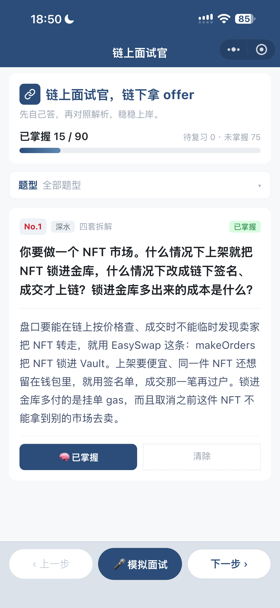
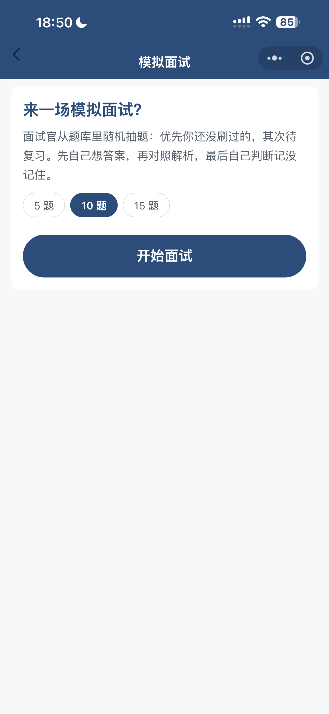
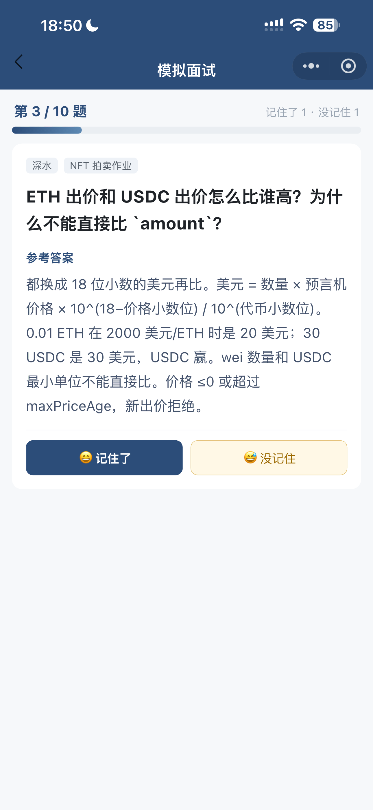

# 链上面试官 · Chain Interviewer

> 链上面试官，链下拿 offer。区块链开发岗面试刷题微信小程序。

「链上面试官」是一个面向区块链开发岗的面试刷题小程序：先自己答，再对照解析，稳稳上岸。

## 截图预览

| 题库刷题 | 模拟面试 · 抽题 | 模拟面试 · 自评 |
|:---:|:---:|:---:|
|  |  |  |

## 功能

- **单题模式刷题**：一屏一题，底部「上一题 / 模拟面试 / 下一题」操作栏，支持左右滑动切题（带方向滑动动画）
- **分类筛选**：90 道题按 15 个分类组织——四套项目拆解、区块链基础、以太坊交易、Solidity、代币标准、签名与安全、工程实践、Go、质押挖矿、Uniswap V2/V3、NFT 拍卖、提款与工具链、ERC/EIP、Go-Ethereum；题型下拉单选，每个分类带专属色标
- **掌握进度标记**：已掌握 / 清除，进度本地存储，跨会话保留；标记掌握时带一声轻快的短铃音效
- **模拟面试**：随机抽题（优先没刷过的，其次待复习），先自己想答案再对照解析，自评记没记住
- **我的进度**：总掌握率 + 分类进度条
- **细节**：全局面震动反馈、禁用 iOS 回弹、自定义藏青主题导航栏

## 数据来源

题库与 [共识笔记 · BlockchainStudy](https://github.com/ustbmz/BlockchainStudy) 复习站同源：`/Users/cnmz/Study/ProjectBreakdown/区块链面试题.md`（90 题 / 15 分类）。

更新题库：改 md → 复习站跑 `node build.js` → 将 `js/interview.js` 的内容同步到本仓库 `data/questions.js`。

## 目录结构

```
├── app.json / app.js / app.wxss   # 全局配置与藏青主题
├── pages/
│   ├── bank/    # 题库（单题模式 + 手势 + 底部操作栏）
│   ├── quiz/    # 模拟面试（随机抽题 → 自答 → 对照 → 自评）
│   └── me/      # 我的进度（总掌握率 + 分类进度）
├── components/
│   └── navigation-bar/          # 自定义导航栏（模板自带）
├── data/
│   └── questions.js             # 题库数据（与复习站同源）
├── docs/                        # README 截图
└── utils/
    ├── store.js                 # 掌握进度本地存储与统计（含分类配色）
    ├── md.js                    # 答案 markdown 轻量渲染
    └── feedback.js              # 震动反馈 + 掌握音效
```

## 开发

微信开发者工具导入本项目即可（JS 基础模版 + Skyline 渲染）。技术栈：原生小程序、glass-easel 组件框架、本地存储，暂无后端依赖。

## 相关仓库

- [BlockchainStudy](https://github.com/ustbmz/BlockchainStudy) —— 区块链开发复习网站「共识笔记」
